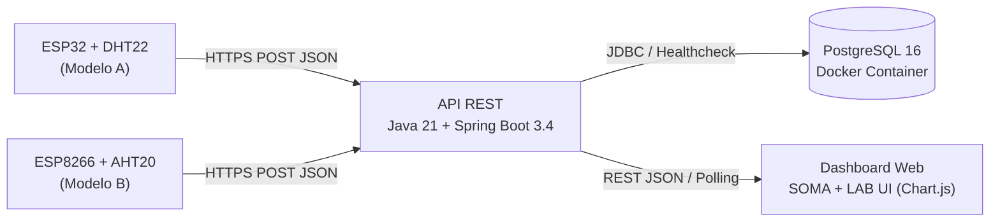
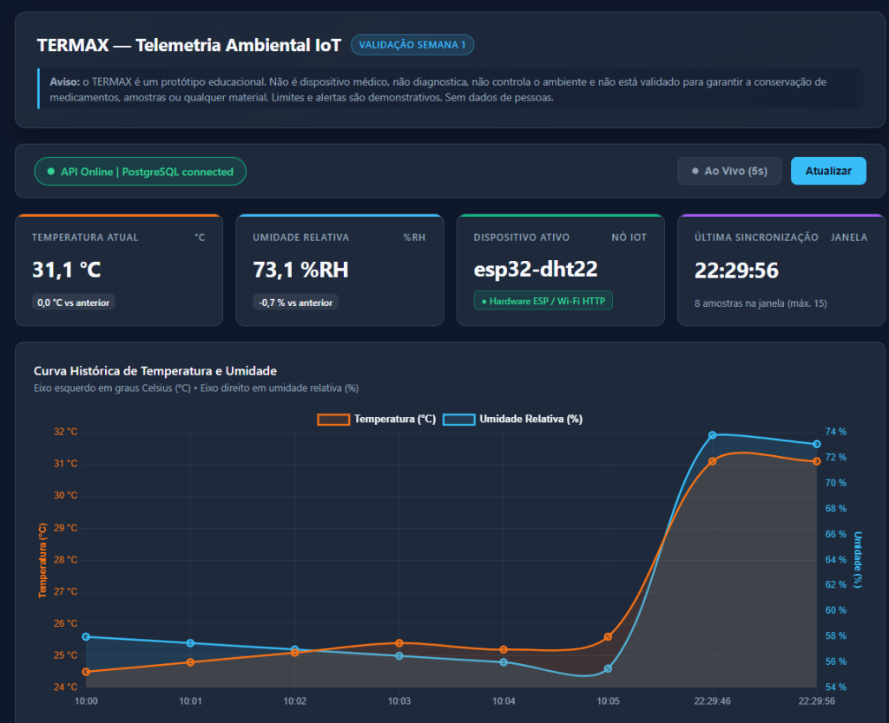
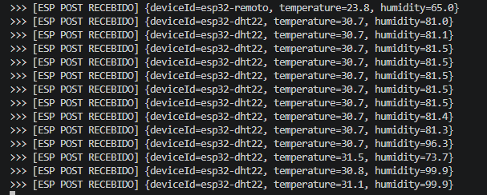
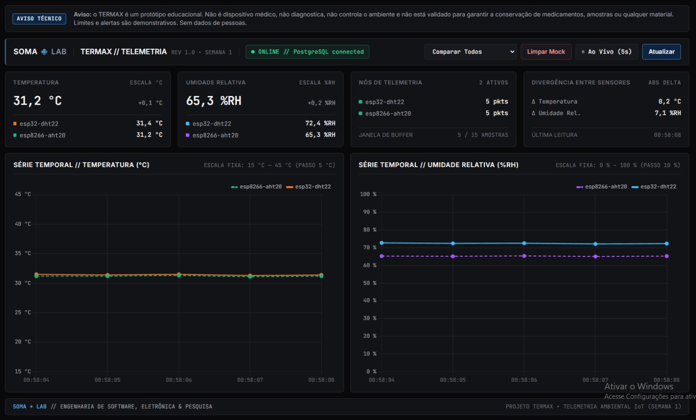

# TERMAX — Sistema de Telemetria Ambiental IoT

**Desenvolvido pela equipe SOMA + LAB** *(Engenharia de Software, Eletrônica & Pesquisa)*


> **Aviso Técnico:** o TERMAX é um protótipo educacional. Não é dispositivo médico, não diagnostica, não controla o ambiente e não está validado para garantir a conservação de medicamentos, amostras ou qualquer material. Limites e alertas são demonstrativos. Sem dados de pessoas.

---

## Visão Geral & Arquitetura

O **TERMAX** é uma plataforma de monitoramento ambiental voltada à coleta, armazenamento e análise comparativa de **temperatura (°C)** e **umidade relativa (%RH)** utilizando nós IoT de baixo custo conectados a um backend REST em Java e visualização web em tempo real.



### Hardware em Avaliação Comparativa

| Modelo | Microcontrolador | Sensor | Protocolo | `deviceId` |
| :--- | :--- | :--- | :--- | :--- |
| **Modelo A (Referência)** | ESP32 (C3 Super Mini) | DHT22 / AM2302 | Digital 1-Wire (GPIO 10) | `esp32-dht22` |
| **Modelo B (Experimental)** | ESP8266 (NodeMCU) | AHT20 | I2C (`SDA=D2`, `SCL=D1`) | `esp8266-aht20` |

---

## Estrutura do Monorepo & Estratégia de Branches

```text
termax/
├── backend/              # API REST em Java 21 + Spring Boot 3.4 (Maven Wrapper)
├── frontend/             # Dashboard Web de Telemetria (HTML5, CSS3, JS, Chart.js)
├── firmware/
│   ├── esp32/            # Firmware C/C++ Modelo A + template secrets.h.example
│   └── esp8266/          # Firmware C/C++ Modelo B + template secrets.h.example
├── sql/                  # Scripts de validação e modelagem DDL (PostgreSQL)
├── docs/                 # Contratos de API, arquitetura, pesquisas e evidências (assets/)
├── docker-compose.yml    # Container PostgreSQL 16 com healthcheck nativo
├── .env.example          # Template público de variáveis de ambiente
└── .gitignore            # Bloqueio de credenciais (.env, **/secrets.h) e artefatos de build
```

* **`main`:** Mantém exclusivamente infraestrutura estável, documentação, templates de segurança e código oficial aprovado.
* **`spike/testes-semana-1`:** Concentra o protótipo funcional descartável da Semana 1 (Backend com DTOs em memória + Dashboard comparativo), preservando o histórico técnico sem poluir a branch principal.

---

## Evolução & Evidências — Semana 1 (Validar Ambiente)

Na primeira semana, além de cumprir 100% do checklist de infraestrutura e validação, a equipe executou testes reais integrando hardware e software de ponta a ponta.

### Marco 1 — Primeira Ingestão Real (Mono-Sensor: `esp32-dht22`)
Validação do fluxo completo **ESP32 → Túnel HTTPS → Spring Boot → PostgreSQL → Chart.js**, recebendo pacotes JSON em tempo real e plotando a transição entre leituras simuladas e dados reais do sensor físico (`31,1 °C` e `73,1 %RH`).



<details>
<summary><strong>Ver evidência dos logs de ingestão recebidos no Backend (Spring Boot)</strong></summary>
<br/>



</details>

---

### Marco 2 — Benchmark Multi-Sensor & Identidade Industrial (`SOMA + LAB`)
Refatoração completa do backend para **Java 21 `records`**, suporte a filas independentes por dispositivo e reconstrução do dashboard com estética industrial escura (tipografia monoespaçada `JetBrains Mono`, escalas fixas sem distorção e cálculo automático de divergência entre sensores).

No teste simultâneo no mesmo ambiente físico, o sistema registrou em tempo real:
* **`esp32-dht22`:** `31,4 °C` | `72,4 %RH`
* **`esp8266-aht20`:** `31,2 °C` | `65,3 %RH`
* **Divergência Absoluta ($\Delta$):** `0,2 °C` em temperatura e `7,1 %RH` em umidade relativa — gerando insumo imediato para a análise de confiabilidade do time de Pesquisa.



---

## Stack Tecnológica & Boas Práticas Aplicadas

* **Backend:** Java 21 (`records` para DTOs imutáveis), Spring Boot 3.4.3, `JdbcTemplate` + HikariCP, SLF4J Logger, validação de limites físicos (`-50 °C` a `100 °C` e `0 %` a `100 %` com `HTTP 400`) e healthcheck resiliente (`HTTP 200 UP` / `HTTP 503 DEGRADED`).
* **Banco de Dados & Infra:** PostgreSQL 16 (`alpine`) via Docker Compose com volume persistente e `healthcheck` (`pg_isready`).
* **Segurança (DevSecOps):** Separação estrita de credenciais via `.env` e `secrets.h` ignorados no Git, com templates `.example` versionados.
* **Frontend:** HTML5/CSS3/JS puro + Chart.js com duplo painel de escalas fixas (`15 °C–45 °C` passo `5 °C` e `0 %–100 %` passo `10 %`), atualização *live* sem *flicker* (`animation: false`) e modo comparativo.

---

## Roadmap de Entregas

### Semana 1 — Validar Ambiente (Concluída)
- [x] Estruturação do monorepo, `README.md` com aviso técnico, `.gitignore` e `.env.example`.
- [x] Blindagem de credenciais de firmware (`secrets.h.example` + bloqueio de `**/secrets.h`).
- [x] Banco de dados PostgreSQL 16 em Docker Compose com `healthcheck` validado no DBeaver.
- [x] API Spring Boot de validação conectada ao banco (`GET/POST/DELETE` + Java 21 `records`).
- [x] Quadro Kanban configurado no GitHub Projects com labels por departamento.
- [x] Dashboard de validação com Chart.js evoluído para modo comparativo multi-dispositivo (`SOMA + LAB`).

### Semana 2 — Definir Arquitetura, Contratos & Design (Em Planejamento)
- [ ] **Software (`BACK + FRONT + EL2`):** Formalizar o contrato oficial da API (endpoints, códigos HTTP e exemplos JSON) em arquivo único (`docs/contrato-api.md`), validado com o firmware.
- [ ] **Software (`BACK`):** Modelar as tabelas relacionais `devices` e `measurements` e criar o script SQL DDL definitivo em `sql/`.
- [ ] **Software (`FRONT`):** Definir o wireframe/protótipo oficial contemplando os 4 estados operacionais (**Sem dados**, **Atualizado**, **Desatualizado** e **Erro**), campos de limites configuráveis e aviso demonstrativo.
- [ ] **Eletrônica:** Finalizar análise de datasheets, esquemas de ligação do Modelo A e lista de compras.
- [ ] **Pesquisa:** Consolidar escopo do MVP (`docs/escopo-mvp.md`), requisitos testáveis (incluindo cenários de falha) e referências técnicas (RDC 430/2020 e fatores de leitura).

---

## Como Executar Localmente

### 1. Subir o Banco de Dados (Docker)
```bash
cp .env.example .env
docker compose up -d
docker compose ps
```

### 2. Executar o Protótipo de Validação (Branch `spike/testes-semana-1`)
```bash
git checkout spike/testes-semana-1
cd backend
./mvnw spring-boot:run   # No Windows PowerShell: .\mvnw.cmd spring-boot:run
```

### 3. Abrir o Dashboard
Abra o arquivo `frontend/index.html` no navegador e ative o modo **Ao Vivo (5s)**.

### 4. Configurar Credenciais do Firmware (Eletrônica)
Copie `firmware/esp32/secrets.h.example` (ou `esp8266/secrets.h.example`) para `secrets.h` na mesma pasta e preencha com seu Wi-Fi e URL da API. O arquivo `secrets.h` nunca será enviado ao GitHub.

---

## Equipe — SOMA + LAB

Projeto multidisciplinar estruturado em três frentes integradas: **Software (Backend, Frontend & Infra)**, **Eletrônica (Hardware & Firmware)** e **Pesquisa (Requisitos, Normas & Validação)**.